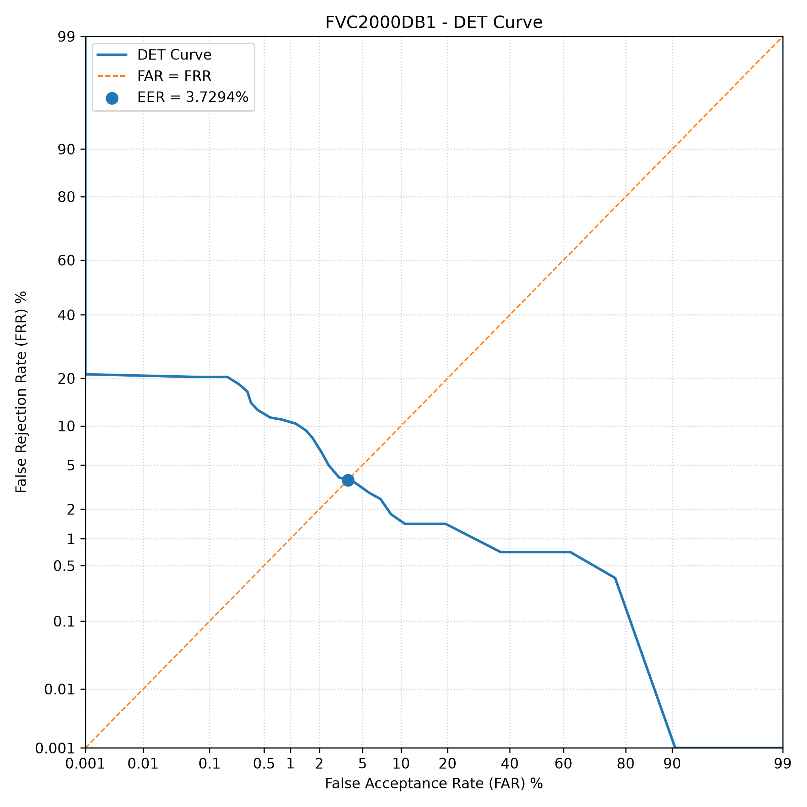
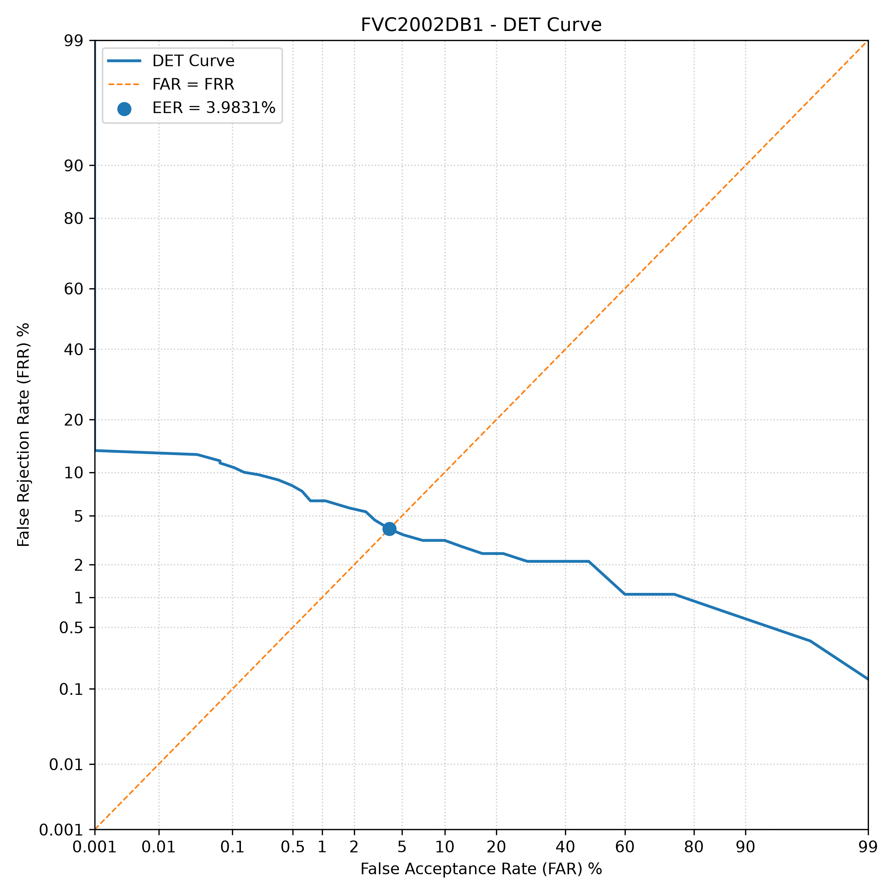
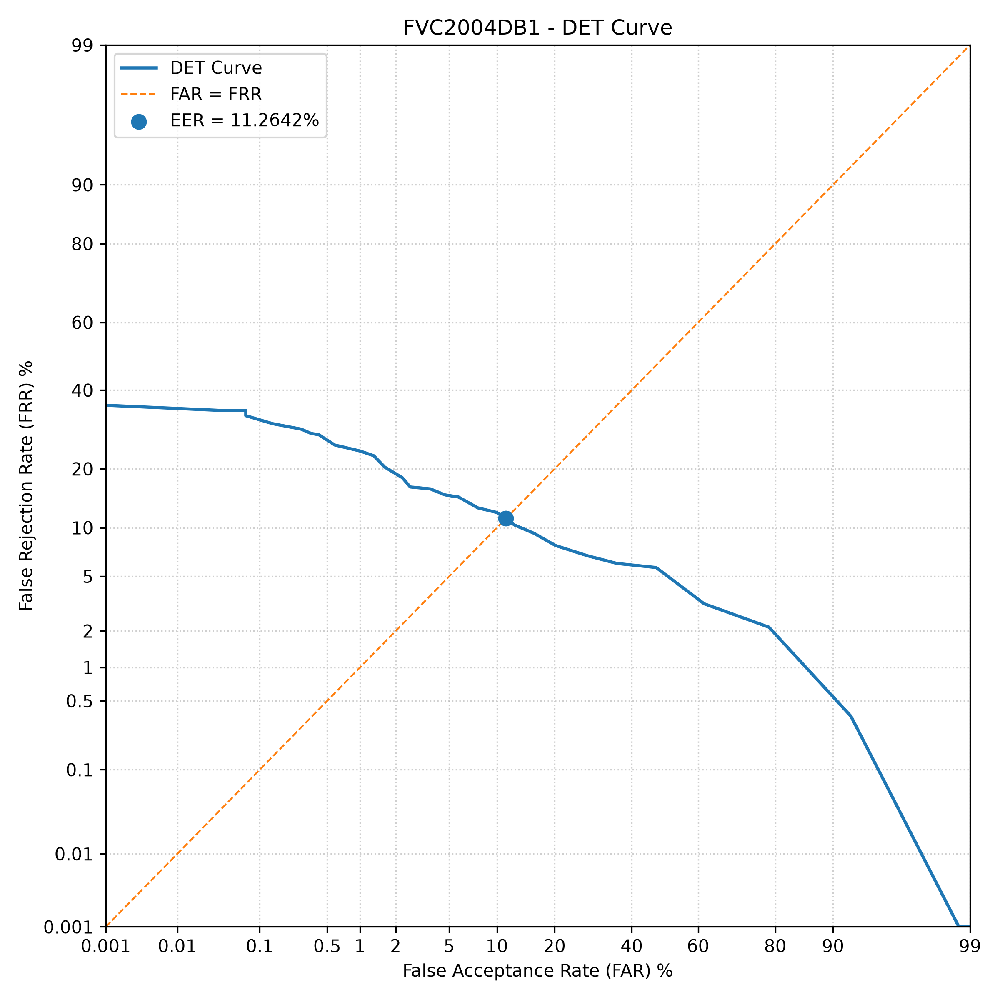
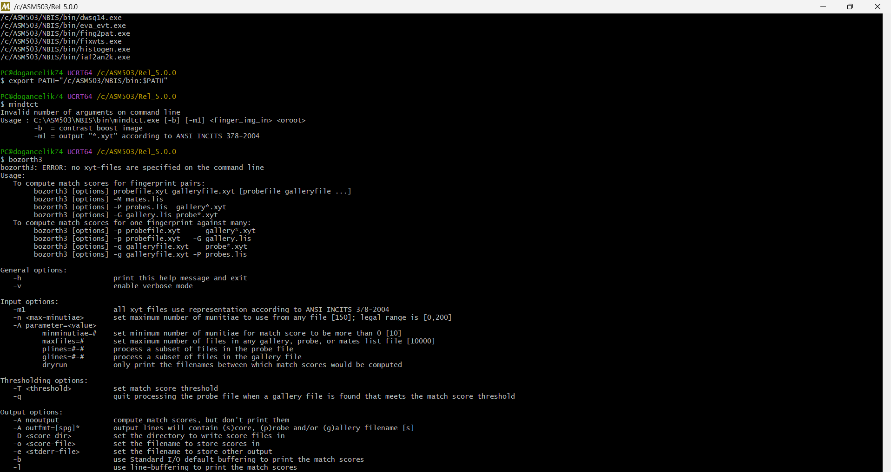
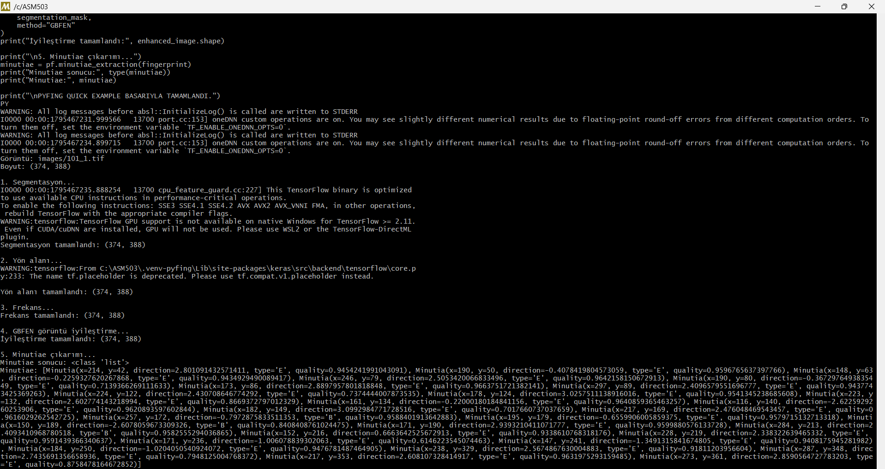
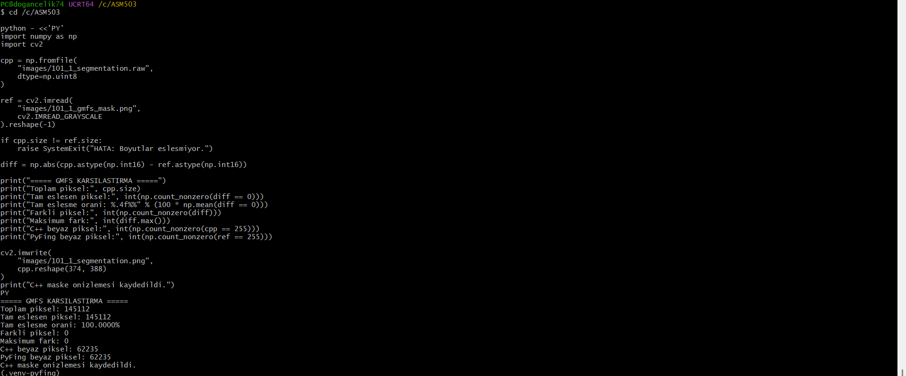
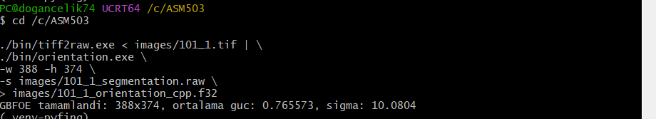
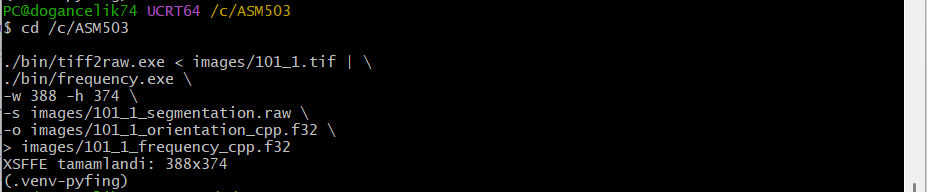
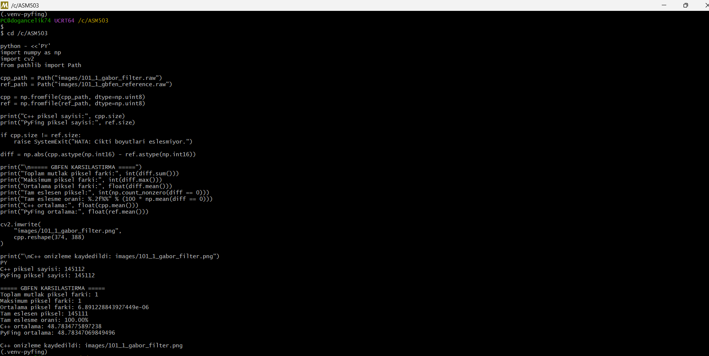

# ASM503 - Parmak İzi Görüntü İşleme ve Eşleştirme Sistemi

## 1. Proje Hakkında

Bu proje, ASM503 dersi kapsamında parmak izi görüntülerinin işlenmesi,
iyileştirilmesi ve biyometrik eşleştirme performansının
değerlendirilmesi amacıyla geliştirilmiştir.

C ve C++ kullanılarak görüntü dönüştürme ve parmak izi işleme araçları
geliştirilmiştir. Görüntüler üzerinde segmentasyon, yön alanı kestirimi,
frekans kestirimi ve Gabor filtreleme işlemleri uygulanmıştır.

İşlenmiş görüntüler NBIS araçlarıyla minutiae verisine dönüştürülmüş,
Bozorth3 kullanılarak parmak izi eşleştirmeleri gerçekleştirilmiştir.

## 2. Kullanılan Teknolojiler

-   C / C++
-   GCC / G++
-   GNU Make
-   OpenCV
-   Python
-   NumPy
-   Matplotlib
-   Pillow
-   PyFing
-   NBIS 5.0.0 (`mindtct`, `bozorth3`)

## 3. Proje Klasör Yapısı

``` text
ASM503/
├── images/                 # Rapor görselleri ve DET grafikleri
├── src/
│   ├── tiff2raw/
│   ├── raw2bmp/
│   ├── raw2an2k/
│   ├── comp_img/
│   ├── segmentation/
│   ├── orientation/
│   ├── frequency/
│   └── gabor_filter/
├── bin/
│   └── results/            # Skorlar ve DET verileri
├── scripts/
│   ├── match.py
│   ├── det.py
│   └── det_plot.py
└── README.md
```

Her C/C++ aracının kendi klasöründe kaynak kodu ve Makefile dosyası
bulunur. Veri setleri ve Gabor filtreleme ara çıktıları proje klasörünün
dışında tutulur.

## 4. Geliştirilen Araçlar

### 4.1 `tiff2raw`

TIFF formatındaki parmak izi görüntülerini 8-bit RAW görüntü verisine
dönüştürür.

### 4.2 `raw2bmp`

RAW görüntü verisini, verilen genişlik ve yükseklik bilgileriyle 8-bit
gri tonlamalı BMP formatına dönüştürür.

### 4.3 `raw2an2k`

RAW görüntü verisini, verilen görüntü boyutlarıyla ANSI/NIST formatına
dönüştürür.

### 4.4 `comp_img`

Aynı boyutlardaki iki adet 8-bit gri tonlamalı BMP görüntüsünü
karşılaştırır.

Hesaplanan ölçütler:

-   **SAD (Sum of Absolute Differences):** Mutlak piksel farklarının
    toplamı.
-   **MAX:** En yüksek tekil piksel farkı.

Kullanım:

``` bash
./bin/comp_img.exe image1.bmp image2.bmp
```

Test sonuçları:

  Test                            SAD   MAX
  ----------------------------- ----- -----
  Aynı görüntü                      0     0
  Kontrollü 4x3 görüntü testi     188   145

Farklı boyutlardaki görüntüler hata mesajıyla reddedilir.

### 4.5 `segmentation` - GMFS

GMFS yöntemiyle parmak izi bölgesini arka plandan ayırır ve segmentasyon
maskesi üretir.

### 4.6 `orientation` - GBFOE

Parmak izi görüntüsünün yön alanını hesaplar. Segmentasyon maskesi
kullanarak arka plan bölgelerini işlem dışında tutar.

### 4.7 `frequency` - XSFFE

Parmak izi sırtlarının yerel frekansını hesaplar. Segmentasyon maskesi
ve yön alanını girdi olarak kullanır.

### 4.8 `gabor_filter` - GBFEN

Yön ve frekans bilgilerini kullanarak Gabor filtreleriyle parmak izi
görüntüsünü iyileştirir.

## 5. Veri Setleri ve Eşleştirme

Çalışmada FVC parmak izi veri tabanlarının DB1 B alt kümeleri
kullanılmıştır:

-   FVC2000 DB1 B
-   FVC2002 DB1 B
-   FVC2004 DB1 B

Her veri setinde 10 farklı parmak izi ve her parmak izi için 8 örnek
olmak üzere toplam 80 görüntü bulunmaktadır.

İşlem sırası:

1.  TIFF görüntülerinin RAW formatına dönüştürülmesi
2.  GMFS ile segmentasyon
3.  GBFOE ile yön alanı kestirimi
4.  XSFFE ile frekans kestirimi
5.  GBFEN ile Gabor filtreleme
6.  NBIS `mindtct` ile minutiae çıkarımı
7.  Bozorth3 ile parmak izi eşleştirmesi
8.  DET eğrisi ve EER hesaplaması

Her veri seti için 80 görüntüden toplam 3160 çift karşılaştırılmıştır.
Bunların 280 tanesi genuine, 2880 tanesi impostor karşılaştırmasıdır. Üç
veri setinin eşleştirme çalıştırmalarında başarısız çift oluşmamıştır.

## 6. Eşit Hata Oranı (EER) Sonuçları

  Veri seti       Genuine   Impostor        EER   EER eşiği
  ------------- --------- ---------- ---------- -----------
  FVC2000 DB1         280       2880    %3,7294     15,4422
  FVC2002 DB1         280       2880    %3,9831     16,0763
  FVC2004 DB1         280       2880   %11,2642     12,5080

EER, yanlış kabul oranı (FAR) ile yanlış ret oranının (FRR) eşitlendiği
noktadaki hata oranını ifade eder. Tablodaki EER değerleri, hesaplanan
DET eğrisi üzerinde FAR ve FRR'nin kesiştiği noktadan elde edilen
enterpolasyonlu sonuçlardır.

Sonuçlar, kullanılan veri setine göre eşleştirme performansının
değiştiğini göstermektedir. Bu sonuçlar, ilgili veri setleri ve
uygulanan işleme/eşleştirme hattı için elde edilmiştir.

## 7. DET Grafikleri

### FVC2000 DB1



### FVC2002 DB1



### FVC2004 DB1



## 8. Kurulum ve İşlem Ekran Görüntüleri

### NBIS kurulumu



### PyFing kurulumu ve örnek çalıştırma



### GMFS segmentasyon



### GBFOE yön alanı



### XSFFE frekans kestirimi



### GBFEN Gabor filtreleme



## 9. Derleme ve Kurulum

Geliştirilen her C/C++ aracı kendi klasöründe bulunan Makefile ile
derlenir. Örneğin:

``` bash
cd src/segmentation
make
make install
```

Diğer araçlar için de ilgili kaynak kodu klasörüne girilerek aynı
komutlar çalıştırılabilir. `make install`, ilgili çalıştırılabilir
dosyayı proje içindeki `bin/` klasörüne kopyalar.

Derleme artıklarını temizlemek için ilgili araç klasöründe:

``` bash
make clean
```

## 10. Python Betikleri

Eşleştirme skorlarını oluşturmak için:

``` bash
python scripts/match.py
```

DET eğrisi verilerini ve EER değerlerini hesaplamak için:

``` bash
python scripts/det.py
```

DET grafiklerini üretmek için:

``` bash
python scripts/det_plot.py
```

Python betiklerinin çalışması için gerekli Python paketleri kurulu
olmalıdır. Veri setleri ile Gabor filtrelenmiş görüntü klasörlerinin
yolları betiklerde tanımlı yapılandırmayla eşleşmelidir.

## 11. Sonuç Dosyaları

`bin/results/` klasöründe her veri seti için aşağıdaki genuine ve
impostor skor dosyaları bulunur:

-   `FVC2000DB1_genuine_scores.txt`
-   `FVC2000DB1_impostor_scores.txt`
-   `FVC2002DB1_genuine_scores.txt`
-   `FVC2002DB1_impostor_scores.txt`
-   `FVC2004DB1_genuine_scores.txt`
-   `FVC2004DB1_impostor_scores.txt`

Aynı klasörde veri setlerine ait eşleştirme CSV dosyaları ve DET eğrisi
CSV dosyaları da bulunur.

## 12. Proje Bağlantıları

-   **GitHub:** `[GitHub depo bağlantısını buraya ekleyin]`
-   **YouTube:** `[Proje tanıtım videosu bağlantısını buraya ekleyin]`

## 13. Notlar

-   FVC veri setleri ve Gabor filtreleme ara çıktıları proje kaynak kodu
    klasörünün dışında saklanmalıdır.
-   Veri setlerinin kullanımında ilgili FVC veri tabanlarının lisans ve
    dağıtım koşullarına uyulmalıdır.
-   Projeyi başka bir bilgisayarda çalıştırırken NBIS, OpenCV,
    derleyici, Make ve gerekli Python paketlerinin kurulmuş olması
    gerekir.
-   Veri seti klasörlerinin konumları farklıysa `scripts/match.py` ve
    ilgili işleme betiklerindeki yol tanımları güncellenmelidir.
